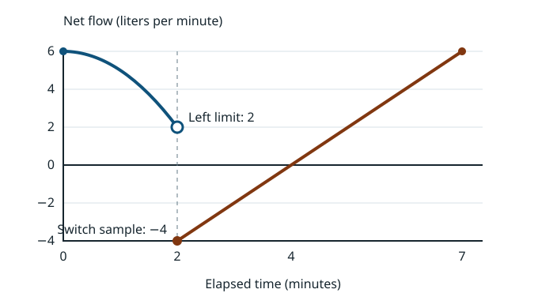

# 1. Limits at a switch

*The value at a timestamp does not tell you what the system was approaching.*

Suppose a nonempty tank starts holding 10 liters. A valve switches at minute 2. Before the switch, more fluid enters than leaves. Immediately after it, more leaves than enters. The signed **net flow** $q$ measures that difference, in liters per minute. It is not the number of liters in the tank.

Write time $t$ in minutes. Our fictional controller model gives $q(t)=6-t^2$ for $0\le t<2$, and $q(t)=2(t-4)$ for $2\le t\le7$. At the switch the second formula owns the sample. A negative reading denotes net outflow. All claims in this book concern this idealized interval, not how quickly a real valve can move.

**By the end:** read a piecewise graph, evaluate left and right limits and distinguish an attained value from an approached value.

## Read three different questions

| Time (min) | Rate (L/min) | Where the number comes from |
| ---: | ---: | --- |
| 1.90 | 2.39 | Before switching |
| 1.99 | 2.0399 | Before switching |
| 2.00 | −4 | Assigned switch sample |
| 2.01 | −3.98 | After switching |
| 2.10 | −3.8 | After switching |

The table suggests two different answers. To establish them under the model, evaluate the limiting expressions: the continuous polynomial $6-t^2$ tends to $2$ as $t$ approaches 2 from below; the continuous line $2(t-4)$ tends to $-4$ as $t$ approaches from above. The open point marks the end approached by the first rule. The filled point is $q(2)=-4$. A two-sided limit exists only if the sides agree, so $\lim_{t\to2}q(t)$ does not exist. Changing only $q(2)$ would not change either limit.

More precisely, a finite limit $L$ says that however small a positive error bound you choose for the output, inputs sufficiently close to the target, but not equal to it, fall within that error bound. At a one-sided limit only the specified side counts. The actual value enters separately: continuity at an interior point requires a defined value, a two-sided limit, and equality between them.

## Where a graph can mislead

Connecting sampled points across the jump inserts rates that the model never supplies at those times. When sketching, mark where one branch stops and the other starts. The vertical distance between approached values is 6 L/min, not a six-liter change in volume. A discontinuity in the rate is not automatically a discontinuity in the total. Later we will compute why.

## Practice unaided

1. Give $q(0)$, $q(4)$, and the units. Explain why the chapter does not predict $q(8)$.
2. If a display labels the instant at minute 2 as zero but leaves the two branches unchanged, give the two limits and the relabeled sample.
3. Find the left-hand limit at minute 7. Explain why a right-hand limit cannot be read from this model.

Use the table or a partner to challenge a sign before asking any optional tool. [Worked checks](../practice/answer-key.md) · [Next: derivatives](02-derive-the-rate.md)
